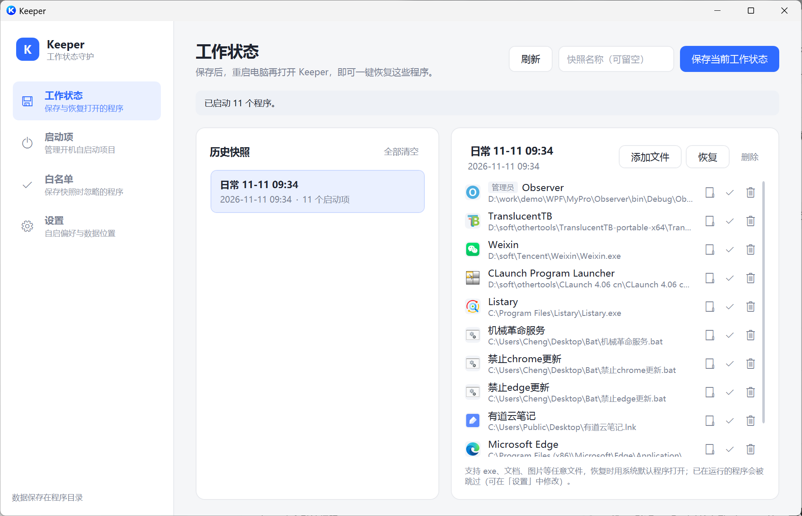
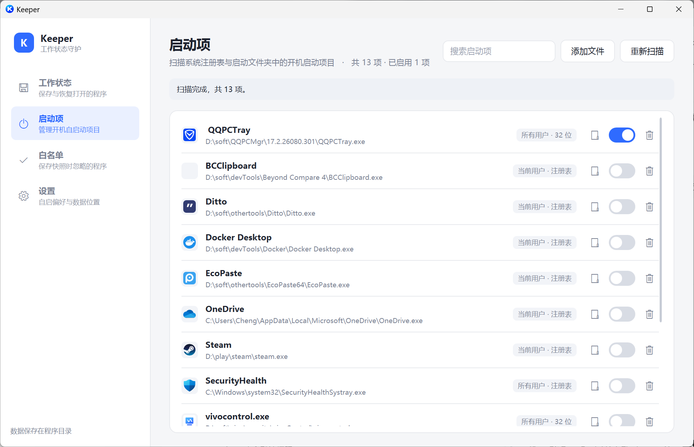
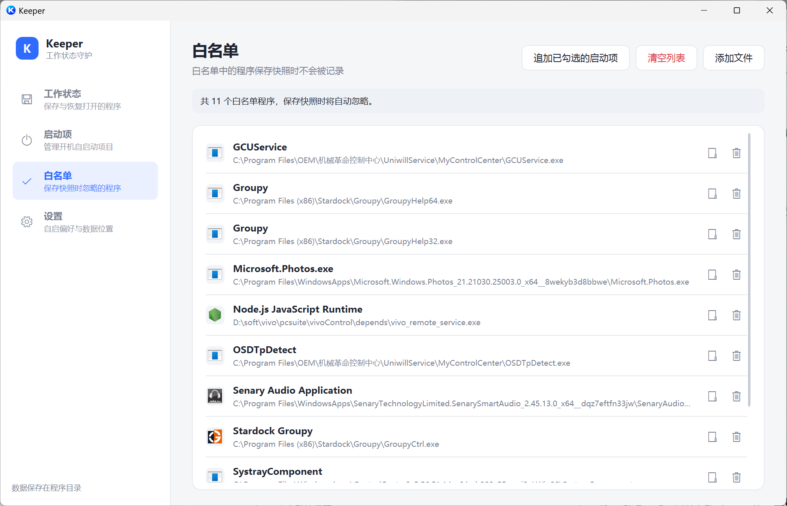

# Keeper · 工作状态守护

> 一键保存当前打开的所有程序，下次开机原样还原。
> 顺手把 Windows 开机启动项也管起来。

一个轻量的 Windows 桌面小工具，用 .NET Framework 4.8 + WPF 写成，单文件发布、数据本地存储、不联网。



---

## 目录

- [它解决什么问题](#它解决什么问题)
- [功能](#功能)
  - [工作状态](#一工作状态)
  - [启动项](#二启动项)
  - [白名单](#三白名单)
  - [设置](#四设置)
- [快速开始](#快速开始)
- [工作原理](#工作原理)
- [技术栈](#技术栈)
- [项目结构](#项目结构)
- [编译与运行](#编译与运行)
- [数据与权限](#数据与权限)
- [已知限制](#已知限制)

---

## 它解决什么问题

每天开机，你大概都要重复同一套动作：打开 IDE、打开浏览器固定那几个页面、开微信、开笔记、开代理……

Windows 自带的"重启后恢复应用"时灵时不灵，而且不认你自己挑的那一组程序。

Keeper 的做法很直白：**把此刻打开的程序清单存成一份快照**，需要的时候点一下，按顺序全部拉起来。快照可以存很多份，按场景命名——"日常"、"开发"、"写文档"。

另外，Windows 的启动项散落在注册表和两个启动文件夹里，Keeper 把它们扫到一张表上，能开关、能删、能加。

---

## 功能

### 一、工作状态

保存和恢复当前打开的程序。

- **保存当前工作状态**：自动采集当前有可见窗口的进程，以及常驻托盘的程序，按可执行文件路径去重
- **手动追加文件**：支持 exe、文档、图片等任意格式，恢复时用系统默认程序打开
- **按需恢复**：列表里逐项勾选，只恢复你要的那几个
- **多份快照**：最多保留 30 份历史快照，支持重命名、单条删除、一键清空
- **单项管理**：快照里的每一项都能单独移除，或者在资源管理器中定位
- **加入白名单**：某个程序不想被记录，一键加白名单并从当前快照移除

恢复结果会给出统计：启动了几个、跳过几个、哪几个失败。

### 二、启动项

把散落各处的开机启动项收拢到一张表。



扫描来源共 5 处：

| 来源 | 位置 |
|---|---|
| 当前用户 · 注册表 | `HKCU\Software\Microsoft\Windows\CurrentVersion\Run` |
| 所有用户 · 注册表 | `HKLM\Software\Microsoft\Windows\CurrentVersion\Run`（64 位视图） |
| 所有用户 · 32 位 | 同上，32 位视图（WOW64） |
| 当前用户 · 启动文件夹 | `%APPDATA%\Microsoft\Windows\Start Menu\Programs\Startup` |
| 所有用户 · 启动文件夹 | `%ProgramData%\Microsoft\Windows\Start Menu\Programs\Startup` |

能做的事：

- **开关**：不改注册表内容，通过 `StartupApproved` 标记启用 / 禁用，随时可逆
- **删除**：注册表项直接删，启动文件夹项删快捷方式并清掉对应的审批标记
- **添加文件**：往用户启动文件夹里建快捷方式，自动跳过重复项和无效路径
- **重新扫描**：装完新软件不用重启 Keeper
- **权限识别**：读取目标 exe 的内嵌清单，判断它是否声明了 `requireAdministrator`

### 三、白名单

白名单里的程序，保存快照时不会被记录。



适合放这些：输入法、显卡驱动面板、同步盘、系统托盘工具、各种后台常驻但你没主动打开的东西。

- 支持从启动项页勾选后批量追加
- 支持手动添加文件
- 支持清空列表
- 匹配按可执行文件的真实路径，快捷方式会先解析到目标

### 四、设置


| 设置项 | 说明 |
|---|---|
| 开机自动启动 Keeper | 注册 Windows 计划任务，登录后以管理员权限启动，**登录时不会再弹权限确认** |
| 启动时自动恢复所选快照 | 可多选，按顺序依次恢复；不选则恢复最近一次 |
| 恢复时跳过已运行的程序 | 关掉后会尝试重新启动每一个程序 |
| 关闭主窗口时 | 询问 / 最小化到托盘 / 直接退出 |

开机自启走的是计划任务而不是注册表 Run 项，原因是 Keeper 需要管理员权限——放进 Run 项的话每次开机都会弹一次 UAC。计划任务在创建时确认一次，之后登录即静默提权启动。

---

## 快速开始

1. 下载 `Keeper.exe`，放到一个**你有写权限的目录**（不要放 `C:\Program Files`，原因见下文）
2. 双击运行，首次会弹一次 UAC —— 程序需要管理员权限才能枚举进程和读写启动项
3. 把当前要用的程序都打开
4. 切到「工作状态」，点右上角 **保存当前工作状态**
5. 下次开机，选中快照点 **恢复**；或者在「设置」里开启启动时自动恢复

---

## 工作原理

```
┌─────────────┐   采集    ┌──────────────┐   持久化   ┌──────────┐
│ 运行中进程   │ ────────▶ │  RunningApp  │ ────────▶ │ SQLite   │
│ (窗口+托盘)  │           │   （模型）    │           │ Keeper.db│
└─────────────┘           └──────────────┘           └──────────┘
                                                            │
┌─────────────┐   恢复    ┌──────────────┐   读取         │
│  ShellExecute│ ◀──────── │ SnapshotItem │ ◀─────────────┘
│  按顺序启动  │           │  + 权限判断   │
└─────────────┘           └──────────────┘
```

几个关键点：

- **采集口径**：只收有可见主窗口的进程，加上托盘宿主进程；系统进程、服务、后台工具靠白名单和内置忽略名单过滤
- **去重口径**：按可执行文件真实路径，不是进程名——同名不同版本的程序不会被误合并
- **恢复方式**：统一走 `ShellExecute`，让系统用默认程序打开，所以文档、图片、快捷方式都能处理
- **权限判断**：读目标 exe 的清单资源，识别 `requireAdministrator`，决定恢复时是否需要提权路径
- **启动时序**：开机自启时先等桌面 Shell 就绪再开始恢复，避免程序起在 Explorer 之前导致窗口不显示

---

## 技术栈

| 项 | 选型 |
|---|---|
| 框架 | .NET Framework 4.8 |
| UI | WPF（XAML + 自定义主题） |
| 架构 | MVVM，手写 `ObservableObject` / `RelayCommand`，无第三方 MVVM 框架 |
| 存储 | SQLite（`System.Data.SQLite`） |
| 打包 | Costura.Fody，DLL 全部内嵌，输出单个 exe |
| 规模 | C# 约 5500 行，XAML 约 1500 行 |

没有网络请求，没有遥测，没有后台服务。

---

## 项目结构

```
Keeper/
├── Data/              数据访问层（SQLite 仓储）
│   ├── Database.cs           连接与建表
│   ├── SnapshotRepository.cs
│   ├── WhitelistRepository.cs
│   └── SettingsRepository.cs
├── Helpers/           工具类
│   ├── AppPaths.cs           路径约定（数据放程序目录）
│   ├── ElevationHelper.cs    读取 exe 清单的权限声明
│   ├── IconLoader.cs         提取程序图标
│   ├── ProcessPathHelper.cs
│   ├── ShellReadyHelper.cs   等待桌面就绪
│   ├── ShortcutHelper.cs     快捷方式解析与创建
│   └── WindowEnumerator.cs
├── Infrastructure/    基础设施（MVVM 基类）
├── Models/            数据模型
├── Services/          业务服务
│   ├── RunningAppService.cs  进程采集
│   ├── SnapshotService.cs    快照保存与恢复
│   ├── AutostartService.cs   启动项扫描与管理
│   ├── SelfStartupService.cs 计划任务自启
│   └── TrayIconService.cs    托盘图标与菜单
├── ViewModels/        各页面的 ViewModel
├── Views/             各页面的 XAML
├── Themes/            统一样式与配色
└── docs/images/       文档截图
```

---

## 编译与运行

**环境要求**

- Visual Studio 2019 / 2022（需安装 .NET Framework 4.8 开发工具）
- .NET Framework 4.8 运行时
- Windows 7 SP1 及以上（主要面向 Windows 10 / 11）

**编译**

```bash
git clone https://github.com/tfyicheng/Keeper.git
cd Keeper
# 用 VS 打开 Keeper.sln，或命令行：
msbuild Keeper.sln /p:Configuration=Release
```

首次编译前需要还原 NuGet 包（`Costura.Fody`、`Fody`、`System.Data.SQLite`）。产物为单文件：

```
bin\Release\Keeper.exe
```

---

## 数据与权限

**数据存储**

所有数据都在程序同目录下的 `Keeper.db`（SQLite）：

- 快照与快照条目
- 白名单
- 配置项

没有云端、没有注册表散落配置。整个目录拷走就是完整迁移，删掉 db 就是恢复出厂。

**关于管理员权限**

程序清单声明了 `requireAdministrator`。必须有这个权限，才能：

- 枚举其他用户 / 提权进程的完整路径
- 读写 `HKLM` 下的启动项
- 结束和管理需要提权的进程

代价也要说清楚：

- 首次运行会弹 UAC
- 提权进程看不到资源管理器里映射的网络驱动器
- 把 exe 放在 `C:\Program Files` 下，`Keeper.db` 会写不进去（那是受 UAC 保护的目录）。**放在用户目录、D 盘工具目录之类的绿色位置最合适**

---

## 已知限制

- **只记录程序，不记录窗口状态**——程序内的文档、标签页、滚动位置不在快照范围内
- **UWP / 商店应用支持有限**——这类应用的快捷方式没有传统的 exe 目标，加进快照可能无法正确恢复
- **`requireAdministrator` 的程序**恢复时可能仍会弹 UAC，这是目标程序自身清单决定的，Keeper 无法代它绕过
- **快照上限 30 份**，超出后需要手动清理旧快照
- 只支持 Windows，不考虑跨平台

---

## License

个人项目，未指定开源协议。使用前请自行评估。
